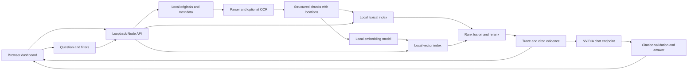

# PRO_RAG architecture

PRO_RAG is a local, single-user document analysis workspace. The browser talks to a Node API on loopback. The API owns document parsing, local indexes, query traces, evaluation, and the NVIDIA chat request. The API key never enters browser code.

## Ingestion

Uploads are validated for format and size, hashed for duplicate detection, then parsed into location-aware blocks. Chunking retains the parent document and available page, slide, sheet, row, or heading coordinates. Only successfully indexed documents become searchable. A failed job remains visible with a retry path and no partial search entries. Original files and canonical chunks persist locally so the search index can be rebuilt.

The target formats are PDF, DOCX, PPTX, XLSX, CSV, TXT, Markdown, and HTML. Scanned PDF extraction uses an optional local OCR path. These are test targets, not a guarantee that arbitrary complex layouts, handwriting, protected files, or embedded images parse perfectly. The document panel reports extraction warnings.

## Retrieval and answering

Baseline mode is lexical retrieval. Advanced mode obtains lexical and local semantic candidates, fuses their ranks with reciprocal rank fusion, then reranks a bounded shortlist using an explicit lexical/semantic/phrase heuristic. This is a second scoring stage, not a cross-encoder. The trace exposes actual stages, timings, scores, filters, and selected chunks. If the local embedding model cannot load, documents remain available to baseline retrieval; hybrid mode reports the model error and can re-embed later. The app does not substitute fake semantic vectors outside the automated test mode.

Generation sends only the selected context and question to the configured NVIDIA model. The prompt asks for source markers. The server checks each returned marker against the actual source list before showing the answer. If evidence is absent, the app abstains. Model output is probabilistic, so citations and evaluation help inspect an answer rather than certify it as true.

## Evaluation

A local golden set stores questions, expected source documents, and answerability. Runs compare baseline and advanced retrieval using recall at k, reciprocal rank, latency, citation validity, and abstention behavior. Recall and reciprocal rank average answerable cases only; unanswerable cases contribute to abstention accuracy. Each run stores fingerprints of its case set and indexed corpus; the UI shows a score difference only when both fingerprints and top K match. The evaluation path makes no NVIDIA request.

## Cost, privacy, and boundaries

Parsing, storage, OCR, embedding, retrieval, and evaluation run locally with open-source tools. First use may download packages and model weights. NVIDIA receives the question plus retrieved document excerpts when generation is requested; its account terms and quota determine whether hosted calls are free. The app makes no subscription or automatic billing commitment. The server binds to loopback by default and has no multi-user authentication, so it must not be exposed publicly as-is.

See the [beginner's guide](BEGINNERS_GUIDE.md) for the user workflow and [testing guide](TESTING.md) for reproducible checks.
